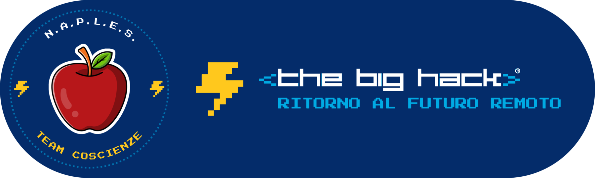

<p align="center">
  
</p>

# N.A.P.L.E.S. — Neapolitan Agentic Platform for Logistics, Experience and Safety

Agenti AI che si coordinano per la resilienza urbana di Napoli. Cinque agenti (Rischio, Mobilità, Folla, Comunicazione e un Orchestratore) leggono la città, si scambiano proposte, risolvono i conflitti e presentano un unico piano alla control room comunale: **l'operatore approva sempre**, il cittadino riceve sul telefono solo gli avvisi che lo riguardano, con la fonte, e ogni passo resta in un registro a catena di hash. Il beneficio si misura: stessi indicatori, stesso scenario, con e senza coordinamento.

Challenge 05 «Napoli Agentic City: la città che Ci pensa» (Fastweb + Vodafone), The Big Hack 2026, Team CoScienze. Il concept completo è in [docs/PROGETTO.md](docs/PROGETTO.md).

## Guarda il progetto all'opera

**Online, senza installare nulla: https://naples-coscienze.web.app**

| Vista | Per chi | Indirizzo |
| --- | --- | --- |
| Control room | L'operatore del Comune, su uno schermo grande | https://naples-coscienze.web.app/control-room |
| Vista cittadino | Chi è in città, sul telefono (si installa sulla home) | https://naples-coscienze.web.app/cittadino |

Il percorso della demo, in tre minuti:

1. Apri la **control room** sul computer e la **vista cittadino** sul telefono, e nella vista cittadino scegli un profilo (tifoso, residente, pendolare, turista in inglese).
2. Nella control room premi **▶ Avvia** (o **⏭ Prossimo evento**): alle 21:55 dello scenario arriva uno sciame sismico **simulato** ai Campi Flegrei. Nella linea del tempo gli agenti si scambiano proposte, l'Orchestratore risolve il conflitto su Piazzale Tecchio e presenta il piano, con il grado di certezza di ogni dato e una spiegazione scritta da Claude.
3. Premi **Approva**: in pochi secondi l'avviso arriva sul telefono, scritto per il profilo scelto e sempre con la fonte. Prova anche **Modifica** e **Rifiuta**.
4. Guarda gli **indicatori con e senza coordinamento** e il **registro delle decisioni**, verificabile.

La sessione è una sola per tutti quelli che aprono il link: se qualcuno avanza o approva, cambia anche per te. **↺ Ricomincia** riporta lo scenario all'inizio. Il primo caricamento dopo una pausa impiega qualche secondo.

### Cosa è reale e cosa è simulato

| Reale, dal vivo | Simulato, ed etichettato a schermo |
| --- | --- |
| Traffico sulle strade e tempi in auto dallo stadio (Google Maps) | Lo sciame sismico e la partita dello scenario |
| Ultimi terremoti di Campi Flegrei e Vesuvio (INGV) | Il testo dell'allerta ufficiale e il post social non verificato |
| Meteo allo stadio (Open-Meteo) | La sospensione di Cumana e Linea 2 |
| Livello di allerta vulcanica ufficiale (mappa della Protezione Civile, letta dal vivo) | Presenze e flussi di persone (il simulatore a zone) |
| Partite al Maradona (football-data.org), concerti in calendario, capienza ufficiale dello stadio | Le stime di ricezione degli avvisi |
| Fermate e coordinate (GTFS ANM ed EAV, OpenStreetMap) | |

Ogni dato simulato e ogni ipotesi sono in [docs/IPOTESI.md](docs/IPOTESI.md). N.A.P.L.E.S. affianca INGV e Protezione Civile, non li sostituisce, e non dà mai istruzioni di evacuazione.

## Stato attuale

Il percorso demo funziona dall'inizio alla fine, online e in locale: regia del tempo, linea del tempo dei messaggi tra agenti, piano con Approva/Modifica/Rifiuta, avvisi per profilo sul telefono in tempo reale, indicatori con e senza coordinamento dal simulatore a zone, registro delle decisioni verificabile. Testi del piano e degli avvisi scritti da Claude con controlli automatici (nessun numero nuovo, nessuna evacuazione, etichetta SIMULAZIONE) e cache; il testo ufficiale non passa mai dal modello. Contesto reale a schermo: traffico Google, terremoti INGV, meteo, livelli vulcanici ufficiali, partite e grandi eventi dei prossimi giorni. Online su https://naples-coscienze.web.app con `make deploy` ([docs/DEPLOY.md](docs/DEPLOY.md)). Script del video pitch in [docs/VIDEO.md](docs/VIDEO.md); dettaglio, compiti aperti e scadenze in [docs/STATO.md](docs/STATO.md).

## Come avviare in locale

Servono [uv](https://docs.astral.sh/uv/), Python 3.12+ e Node 22+. Alla prima volta: `make install` (dipendenze della web app).

- `make check`: file base, `.env` non tracciato, lint e test degli agenti, contratto API allineato, test del backend, lint e build del frontend.
- `make agents-run`: API degli agenti su http://localhost:8001 (porta concordata con la web app), documentazione su http://localhost:8001/docs.
- `make prova`: tre prove dello scenario (l'operatore approva subito, tardi, mai) con rapporti leggibili in `docs/prove/`; vedi [docs/prove/README.md](docs/prove/README.md).
- `make verifica-registro`: verifica il registro delle decisioni scritto dalla demo (`agents/var/registro.jsonl`); con `FILE=percorso` un altro file. Fallisce e indica la riga se qualcosa è stato cambiato a mano.
- Web app in sviluppo, tre terminali: `make agents-run` (agenti), `make backend` (http://localhost:8000), `make frontend` (http://localhost:5173, si ricarica a ogni modifica).
- `make build`: compila la PWA in `frontend/dist`, servita dal backend su http://localhost:8000.
- `make contracts`: rigenera `contracts/agenti.openapi.json` dopo aver cambiato modelli o API.
- `make llm-cache`: registra i testi di Claude per il percorso demo (serve `LLM_API_KEY` in `.env`).

**Dove guardare in locale.** La porta 8001 è solo l'API degli agenti (`/docs`, `/api/...`): le pagine web stanno sulla 5173 in sviluppo (http://localhost:5173/control-room e http://localhost:5173/cittadino) o sulla 8000 dopo `make build`.

## Messa online

Un comando, da rilanciare uguale per ogni aggiornamento:

```sh
gcloud auth login                       # una volta per PC
gcloud config set project <ID_PROGETTO> # una volta per PC
make deploy
```

Indirizzo pubblico: **https://naples-coscienze.web.app** (`/control-room`, `/cittadino`). Pubblica su Google Cloud Run a Milano, con l'indirizzo leggibile su Firebase Hosting: un container con agenti e web app, chiavi da `.env` copiate in Secret Manager, account di servizio dedicato, una sola istanza (la sessione demo sta in memoria), spento quando nessuno lo usa. Alla fine stampa gli indirizzi di control room e vista cittadino. Installazione di gcloud, dettagli e soluzione dei problemi in [docs/DEPLOY.md](docs/DEPLOY.md).

## Struttura del repository

- `CLAUDE.md`: regole di lavoro per Claude Code, lette in automatico
- `README.md`: stato e registro delle modifiche
- `Makefile`: `make check`, eseguito prima di ogni commit, e i comandi degli agenti
- `.env.example`: nomi delle variabili d'ambiente, senza valori
- `agents/`: modulo agenti in Python (API FastAPI, scenario, test); vedi [agents/README.md](agents/README.md)
- `backend/`: gateway FastAPI della web app (porta 8000): serve la PWA, inoltra agli agenti, canale in tempo reale; vedi [backend/README.md](backend/README.md)
- `frontend/`: web app PWA in React, viste `/control-room` e `/cittadino`; vedi [frontend/README.md](frontend/README.md)
- `contracts/`: contratti tra i moduli; vedi [contracts/README.md](contracts/README.md)
- `docs/PROGETTO.md`: concept del progetto
- `docs/PIANO.md`: piano di lavoro (decisioni, architettura, contratti, compiti, orari e tagli)
- `docs/GUIDA.md`: guida del team (prompt, template, regole per i tre PC)
- `docs/TEAM.md`: componenti del team, utenti GitHub ed email per i commit
- `docs/STATO.md`: scadenze, chi lavora su cosa, fatto e compiti liberi
- `docs/IPOTESI.md`: dati simulati e ipotesi
- `docs/img/`: logo del team
- `docs/STAND.md`: risposte dello sponsor e degli organizzatori
- `docs/FEEDBACK.md`: prove fatte a mano dal team

## Team

Team CoScienze. Componenti in [docs/TEAM.md](docs/TEAM.md).

## Registro delle modifiche

| Data | Ora | Modulo | Modifica |
| --- | --- | --- | --- |
| 2026-11-14 | 20:25 | agents | Capacità di Linea 2, Cumana e bus calcolate dalle corse vere (GTFS ANM, EAV) al posto degli ordini di grandezza; sensibilità ricalcolata |
| 2026-11-14 | 20:00 | agents, webapp | Lo scenario è la prova generale della prossima partita vera al Maradona (oggi Napoli – Torino, sab 21/11): partita reale, sciame simulato |
| 2026-11-14 | 19:55 | webapp | Mappa nella vista cittadino: traffico reale, stadio, stazioni aperte o chiuse, punti di raccolta, con elenco che resta anche offline |
| 2026-11-14 | 19:40 | webapp | Niente più testi sovrapposti: livello vulcanico che va a capo nel contesto reale, indicatori e registro uno sotto l'altro su tablet; nella vista cittadino «Napoli oggi e nei prossimi giorni» a tutta larghezza, senza rettangolo grigio |
| 2026-11-14 | 19:25 | agents | Aggiunto `tzdata`: su Windows gli agenti non partivano («No time zone found with key Europe/Rome») e la web app restava senza dati |
| 2026-11-14 | 19:40 | docs, webapp | Logo nel README, sezione «Guarda il progetto all'opera» con il percorso demo e cosa è reale o simulato; pagina iniziale con le foto del golfo, le due viste e i passi della demo |
| 2026-11-14 | 19:45 | agents, webapp | Livello di allerta vulcanica ufficiale dal vivo (Protezione Civile), concerti veri al posto degli esempi, capienza reale del Maradona |
| 2026-11-14 | 19:30 | agents | Luoghi reali: coordinate delle zone da GTFS ANM/EAV e OpenStreetMap, area degli avvisi sul contorno vero dello stadio e sulle fermate vicine |
| 2026-11-14 | 19:25 | agents, webapp | Contesto reale a schermo: livello vulcanico verificato (Campi Flegrei giallo, Vesuvio verde, fonte INGV-OV), terremoti INGV e meteo veri in control room, meteo vero nella vista cittadino |
| 2026-11-14 | 19:15 | agents, webapp | «Napoli oggi e nei prossimi giorni»: eventi previsti (partite reali + elenco curato), zone, orari critici, fermate da evitare e alternative |
| 2026-11-14 | 18:55 | webapp | Control room: il piano non scorre più sopra il registro, Approva/Modifica/Rifiuta in cima al piano, niente spazi vuoti in fondo alla pagina, registro leggibile nella colonna stretta |
| 2026-11-14 | 18:56 | agents, contracts | F1 + F2: contesto reale in `/api/contesto` (terremoti INGV ai Campi Flegrei e al Vesuvio, meteo Open-Meteo), con stato di ogni fonte e copia di riserva |
| 2026-11-14 | 18:51 | webapp | Regia del tempo in control room: l'orologio dello scenario avanza da solo e si ferma quando arriva un piano |
| 2026-11-14 | 18:50 | deploy, webapp | Indirizzo pubblico https://naples-coscienze.web.app (Firebase Hosting davanti a Cloud Run); canale in tempo reale diretto su Cloud Run tramite `events_url` in `/api/config` |
| 2026-11-14 | 18:46 | docs | Checkpoint 1 con i mentor (14:50) in docs/FEEDBACK.md; copie iCloud escluse da git |
| 2026-11-14 | 18:40 | deploy | `make deploy`: messa online su Cloud Run in un comando, chiavi in Secret Manager, account di servizio dedicato, container senza root, regione Milano |
| 2026-11-14 | 18:35 | webapp | C3: piano in control room con Approva, Modifica e Rifiuta, sempre visibili su desktop; gli avvisi approvati arrivano in diretta alla vista cittadino; mappa non più allungata |
| 2026-11-14 | 18:32 | webapp | U1: vista cittadino per profilo (tifoso, residente, pendolare, turista in inglese) e conferma di lettura anonima |
| 2026-11-14 | 18:27 | webapp | C4: registro delle decisioni nella control room, con stato della catena e pulsante di verifica |
| 2026-11-14 | 18:24 | webapp | C5: indicatori con e senza coordinamento nella control room, con l'origine di ogni numero e l'affollamento per zona |
| 2026-11-14 | 18:15 | agents | B5 e K1: sintesi del piano e messaggi per profilo scritti da Claude, con controlli automatici e cache del percorso demo (`make llm-cache`); nuovi campi `sintesi_modello` e `messaggio_modello` |
| 2026-11-14 | 18:15 | agents | Strato LLM (L0): Claude Opus 5.5 con SDK ufficiale, cache su file, ripiego sul testo a regole; `GET /api/llm`, `POST /api/llm/prova` |
| 2026-11-14 | 18:10 | agents | P1: `make prova` salva tre prove in docs/prove/ con controlli automatici; corretto «1 scosse» negli avvisi |
| 2026-11-14 | 18:10 | webapp | Vista cittadino: riquadro «Partite al Maradona» con il calendario reale da football-data.org |
| 2026-11-14 | 18:00 | agents | Partite reali al Maradona: `GET /api/partite` da football-data.org, con copia per l'offline (nuovo nel contratto) |
| 2026-11-14 | 18:03 | webapp, agents | C2: linea del tempo dei messaggi tra agenti nella control room; nomi leggibili di luoghi e agenti nei conflitti |
| 2026-11-14 | 17:43 | agents, contracts | B3: conferma di ricezione reale per telefono anonimo e stime dichiarate; `ConfermaVisto` e nuovi campi di `Ricezione` nel contratto |
| 2026-11-14 | 17:33 | agents | R1: registro delle decisioni scritto su file e `make verifica-registro`, che rileva righe cambiate, tolte o spostate |
| 2026-11-14 | 17:27 | agents | B4: indicatori dal simulatore a zone, congestione per zona, tempi misurati in sessione; sensibilità rivista con lettura onesta |
| 2026-11-14 | 17:20 | agents, webapp | Traffico reale: `GET /api/traffico` da Google Routes API, mappa con livello traffico in control room, chiave del browser da `/api/config`; Dockerfile e docs/DEPLOY.md per Cloud Run |
| 2026-11-14 | 17:19 | agents | B1: la simulazione della sessione segue le decisioni approvate; impatto stimato in ogni piano |
| 2026-11-14 | 17:12 | agents | S0: simulatore a zone di Fuorigrotta, funzione pura con persone conservate, code e linee riattivate |
| 2026-11-14 | 17:04 | agents | B2: modifica del piano reale (esclusione di proposte, registro, niente esclusione delle allerte ufficiali) |
| 2026-11-14 | 17:04 | contracts | `Piano` ha `proposte_escluse` e `motivo_modifica` |
| 2026-11-14 | 16:58 | agents | Profilo «pendolare flegreo» negli avvisi: navette per Bagnoli e Pozzuoli, rimando alla Protezione Civile |
| 2026-11-14 | 16:58 | contracts | `Alert.pubblico` ammette anche `pendolare` |
| 2026-11-14 | 16:50 | webapp | Viste allineate alle specifiche: avvisi con indicazioni operative, certezza e caso A/B; control room con i riquadri previsti; adattive su telefono, tablet e computer; raggiungibili dal telefono sulla stessa Wi-Fi; tolto l'endpoint di prova del canale, etichette «simulato» e «da verificare» sui dati della control room |
| 2026-11-14 | 16:45 | agents | Allerta ufficiale con cornice in inglese per il turista, testo ufficiale identico; filtro avvisi per profilo senza doppioni |
| 2026-11-14 | 16:40 | repo | Tolti i marcatori di conflitto finiti su main con il commit fba8d7e in README.md e docs/STATO.md |
| 2026-11-14 | 16:35 | agents | Budget anti-allarme, cessato allarme operativo (`Cancel`), linee riattivate al minuto 130, conflitto mostrato una volta; scenario di 170 minuti |
| 2026-11-14 | 16:25 | docs | Script del video pitch in docs/VIDEO.md: otto scene entro 3 minuti, con chiusura su app per smartphone e controllo in tempo reale da SIM e telecamere |
| 2026-11-14 | 16:25 | agents | Numeri credibili: corretto il ritardo d'informazione senza coordinamento, capacità ricalibrate, tabella di sensibilità |
| 2026-11-14 | 16:25 | docs | docs/IDEE.md: check di 4 agenti esperti di smart city, idee per stasera, visione e tagli motivati |
| 2026-11-14 | 16:00 | webapp | Scheletro della web app (W0): gateway FastAPI su 8000 verso gli agenti su 8001, canale in tempo reale, PWA React con control room e vista cittadino, tipi generati dal contratto; `make check` esteso alla web app |
| 2026-11-14 | 15:45 | agents | B0: models e api divisi per area, bus dei messaggi, stub dei contratti nuovi, `make prova`, API sulla porta 8001 |
| 2026-11-14 | 15:40 | docs | Piano di lavoro in docs/PIANO.md, costruito sul modulo agenti; compiti liberi e orari aggiornati in docs/STATO.md |
| 2026-11-14 | 15:30 | repo | Tolti i marcatori di conflitto rimasti in README.md e docs/STATO.md |
| 2026-11-14 | 15:22 | repo | docs/TEAM.md: aggiornata l'email dei commit di Leonardo Monaco |
| 2026-11-14 | 15:20 | agents | Modulo agenti in Python: cinque agenti, scenario Maradona simulato, registro a hash, indicatori, API e contratto OpenAPI |
| 2026-11-14 | 15:00 | docs | Approccio quantistico tra gli sviluppi futuri in PROGETTO.md (ottimizzazione QUBO, firme post-quantum) |
| 2026-11-14 | 14:55 | docs | Decisioni in PROGETTO.md: web app PWA con due viste e gestione degli alert con formato CAP |
| 2026-11-14 | 14:40 | repo | Checklist di consegna in docs/STATO.md, team da cinque persone in CLAUDE.md |
| 2026-11-14 | 14:22 | repo | Aggiunta docs/TEAM.md e regola dei Co-authored-by nei commit |
| 2026-11-14 | 14:13 | repo | Preparazione del repository: regole, stato, ipotesi, concept, `make check` minimo |
